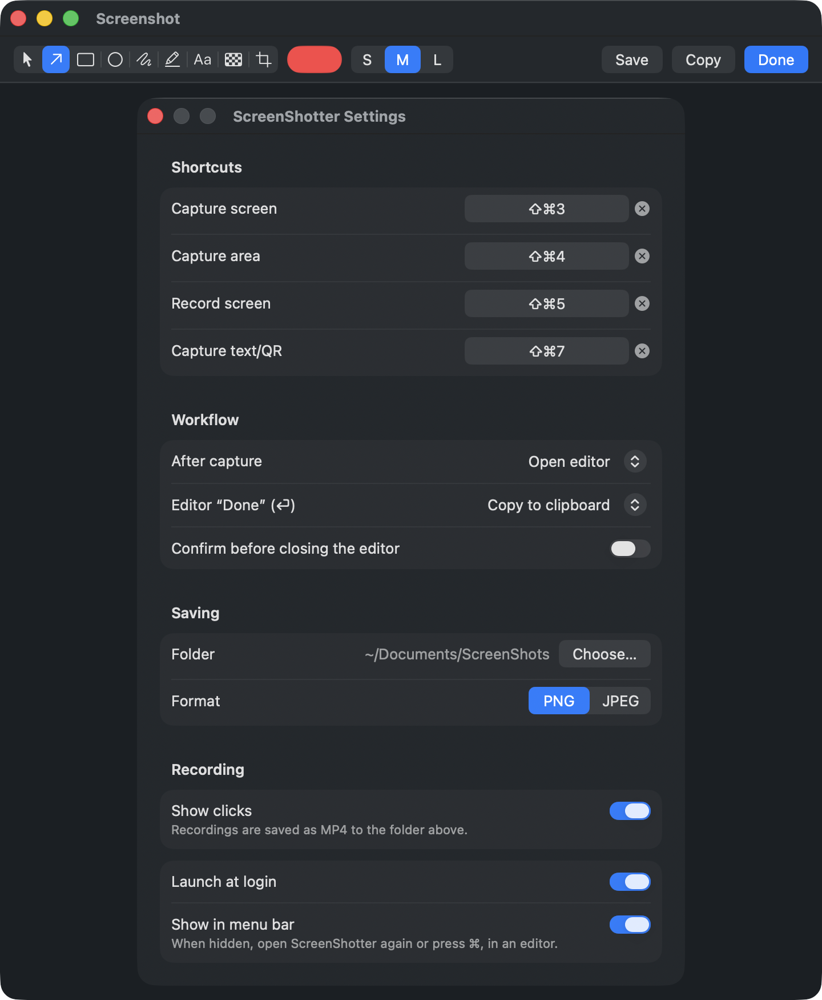

<p align="center">
  
</p>

<h1 align="center">ScreenShotter</h1>

A native macOS screenshot tool:
shortcut → (optional) edit → copy to clipboard / save to folder.



Requires macOS 14+.
Properly tested only on 26.5.2.

## Usage

| Default shortcut | Action |
| --- | --- |
| ⇧⌘3 | Capture the screen under the mouse |
| ⇧⌘4 | Capture an area (drag; click = whole display; hold ⌥ on release to trim uniform margins; Esc / right-click cancels) |
| ⇧⌘7 | Capture text/QR: select an area, its text (or QR code contents) is copied |
| ⇧⌘5 | Record the screen (macOS 15+): click for the whole display or drag an area; press again or click ⏹ in the menu bar to stop. Saved as MP4 to the screenshots folder |

Unassign system shortcuts in System Settings → Keyboard → Keyboard Shortcuts -> Screenshots to avoid conflicts.


## Build & run

```sh
just run       # build build/ScreenShotter.app and launch it
just install   # copy to /Applications and launch
just test      # image rendering, export, OCR/QR, and crop regression checks
```

The OCR/QR tests require access to macOS Vision and Core Image services; run them
from a normal local terminal rather than a restricted shell sandbox.

On first capture macOS asks for **Screen & System Audio Recording** permission
(System Settings → Privacy & Security). Relaunch the app after granting it.

The build script signs with your "Apple Development" identity if one exists, so
the permission survives rebuilds. Set `SIGN_IDENTITY=-` for ad-hoc signing (you
will then need to re-grant the permission after every rebuild).

## Screen Recording permission after switching builds

macOS ties Screen Recording permission to the app’s signature. Installing another
ad-hoc build can leave ScreenShotter enabled in System Settings while captures
still fail. Toggling the existing permission off and on may not fix it.

Try a capture and choose **Reset Permission…** in the error dialog. This clears
only ScreenShotter’s Screen Recording permission. Open System Settings from the
next dialog, enable ScreenShotter, and relaunch it. If it isn’t listed, click **+**
and select the app at the path shown in the dialog. Save open screenshots before
restarting.
